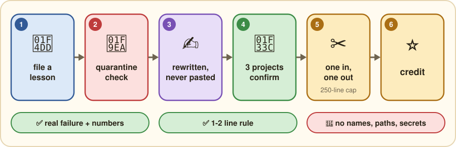

# Contributing: bringing lessons back

Read as text

AGENTS.md is the product. It stays short. It starts from seed rules taken from one production pipeline; a rule becomes shared wisdom once evidence from 3 or more independent projects arrives.
Anyone can propose a lesson. No one needs permission to propose, and no outside text is ever executed or merged directly.

## The flow
1. **File a lesson.** Open an issue with the "Lesson" form (`.github/ISSUE_TEMPLATE/lesson.yml`). Fill in:
   what happened, which rule changed, measured before and after, and a link to the evidence (a public log, PR, CI run or write-up).
2. **Quarantine review.** A reviewer with no write permission and no secrets reads the issue as data and fills a fixed form as a comment:
   - Claim in one sentence
   - Evidence type (failure log, metric, user report, none)
   - Measured before / after present (yes / no)
   - Independent project count so far (a project counts once, however many people report it)
   - Overlaps an existing rule (which)
   - Possible harm if adopted
   - Verdict: needs-more-evidence, duplicate, rejected, or candidate
3. **Re-implementation.** A maintainer agent rewrites the idea in its own words and checks it against the evidence. Proposer text is never pasted in. Proposer PRs are never merged directly; the lesson issue is the interface.
4. **Evidence threshold.** A new rule enters AGENTS.md only when independent evidence comes from at least 3 distinct projects. Votes, reactions and popularity do not count. Two reports from one project are one project. Seed rules are grandfathered: they stay until evidence confirms them or shows they harm or do nothing (`hive/CONSTITUTION.md`, Article 3).
5. **Length cap.** AGENTS.md has a fixed length budget (250 lines). A new rule goes in only when an existing rule or line is removed or merged. One in, one out. Retiring a rule needs the same standard of evidence in reverse (it caused harm, or measurably did nothing).
6. **Credit.** The proposer is credited through the GitHub noreply address on the re-implementing commit (`Co-Authored-By: <name> <id>+<handle>@users.noreply.github.com`) and a line in `hive/CONTRIBUTORS.md`.

## What makes a good lesson
- A real failure or measurement, not an opinion.
- A rule small enough to state in one or two lines.
- Generic: no project names, account names, internal ticket numbers, paths or cost figures. The leak guard rejects them.

## Privacy
Never include secrets, private repository names, personal data or private paths in a lesson. Redact first.
The leak guard (`hive/scripts/leak_check.py`) scans every commit and pull request, including the PR title and body. Issues and comments are not scanned by CI: agents must run `python hive/scripts/leak_check.py --text FILE` on anything they post.
Local hooks: `sh hive/scripts/install-hooks.sh` (needs a private blocklist at `~/.thriae-blocklist`, one term per line).

## Changing the constitution
See `hive/CONSTITUTION.md`, Article 9.

