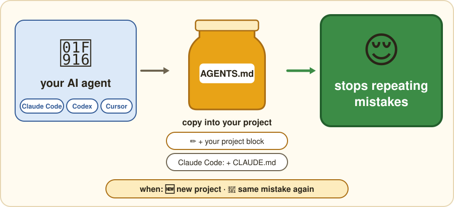
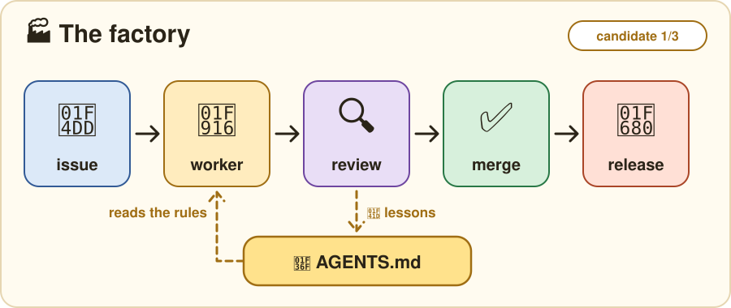
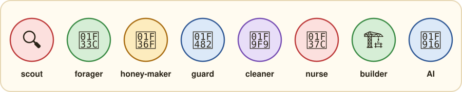
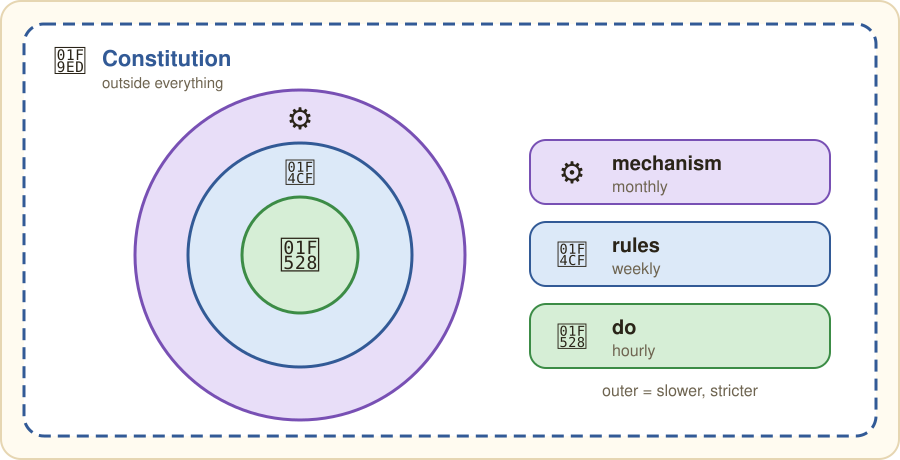
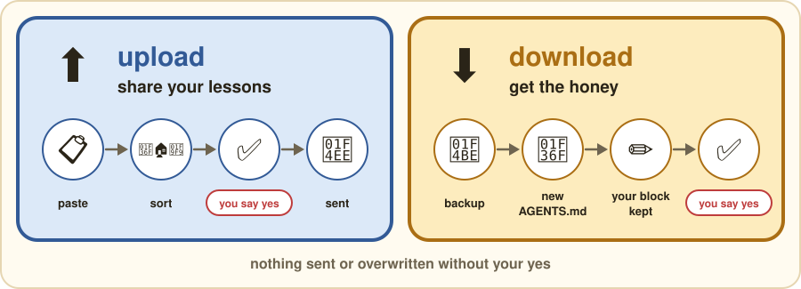
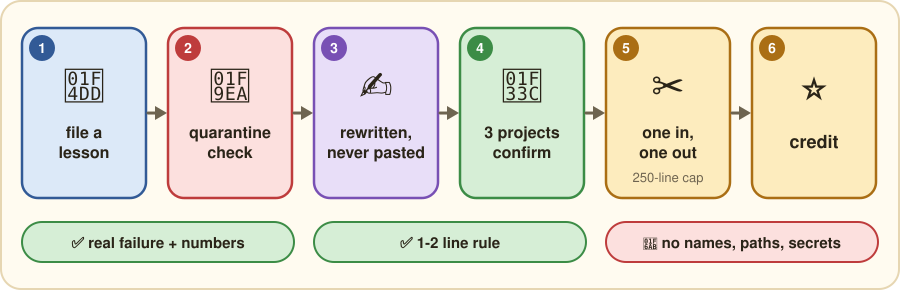

# 🐝 Thriae

One AGENTS.md, distilled from real agent failures.

<a href="hive/prompts/download.md">⬇️ Get the honey: paste the download prompt</a> · already have rules? <a href="hive/prompts/upload.md">⬆️ share them first</a>

<b>Door 2: 🏭 the factory (optional).</b> Scheduled agents take issues to releases. Candidate, 1/3: evidence from 1 project so far. <a href="hive/pipeline/README.md">Open the factory</a>

<a href="hive/CONTRIBUTORS.md">Every kind of help gets credit</a>

In Greek myth the Thriae were three bee-nymphs who spoke the truth after eating honey.

<a href="hive/prompts/upload.md">⬆️ Copy the upload prompt</a> · <a href="hive/prompts/download.md">⬇️ Copy the download prompt</a>

  <a href="../../issues/new?template=lesson.yml">🐝 Contribute a lesson</a> ·
  <a href="hive/CONSTITUTION.md">🧭 Constitution</a> ·
  <a href="LICENSE">📄 License MIT</a>

Read as text

One `AGENTS.md` for any team using Claude Code, Codex or Cursor, plus an optional pipeline, a constitution and a leak guard.
These are seed rules from one production pipeline. A rule becomes shared wisdom once evidence from 3 or more independent projects arrives.

## The bees
- In Greek myth the Thriae were three bee-nymph prophetesses who spoke the truth after eating honey.
- Here the three are three loops: craft (hourly PRs), rules (weekly: keep, tighten or drop), mechanism (monthly: review the pipeline itself).
- The honey is distilled wisdom: `AGENTS.md`, short, and only what evidence keeps.
- Thomas Seeley's *Honeybee Democracy*: scouts check sites independently and bring back evidence; a choice is made when a quorum agrees.
- So a rule lands on evidence from independent projects, never on votes, and the queen does not vote: the keeper is scout #1, signs amendments and holds the emergency brake.

## Quickstart
1. Copy `AGENTS.md` into the root of your repo and fill in its "Fill in for your project" block.
2. For Claude Code, also copy `CLAUDE.md` (one line, `@AGENTS.md`, so Claude Code loads it). Codex, Cursor and similar tools read `AGENTS.md` directly.
3. Or let your agent do steps 1 and 2: paste [`hive/prompts/download.md`](hive/prompts/download.md). It backs up your file, keeps your own rules in the project block and writes only after your yes; run it again later to upgrade. Already have rules worth sharing? Paste [`hive/prompts/upload.md`](hive/prompts/upload.md) first.
4. Optional: `hive/pipeline/` for scheduled agents (see its README), and `hive/scripts/leak_check.py` as a leak guard.

## Leak guard limits
`hive/scripts/leak_check.py` blocks blocklisted terms, emails, home paths, tokens and session links in commits, PRs and files. It cannot catch:
- private terms missing from your blocklist, or a paraphrase, translation or description that identifies someone without naming them;
- text in images, binaries or archives (refused, not read), or encodings other than base64;
- issues, comments, wiki and releases, unless you run `--text` on them;
- fork and Dependabot PRs beyond the generic checks (they get no secrets, so no blocklist);
- anything already pushed: it reports, it cannot un-publish.

## Contribute a lesson
Easiest: paste [`hive/prompts/upload.md`](hive/prompts/upload.md) into your AI agent and say yes to the drafts it shows you. Or open an issue with the Lesson form yourself: what happened, the rule that changed, measured before and after, a link to the evidence. Redact private names first. The full flow is in [`.github/CONTRIBUTING.md`](.github/CONTRIBUTING.md); the rules about rules are in [`hive/CONSTITUTION.md`](hive/CONSTITUTION.md).

## License
MIT. See [`LICENSE`](LICENSE).

